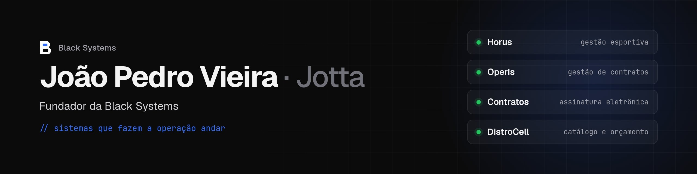
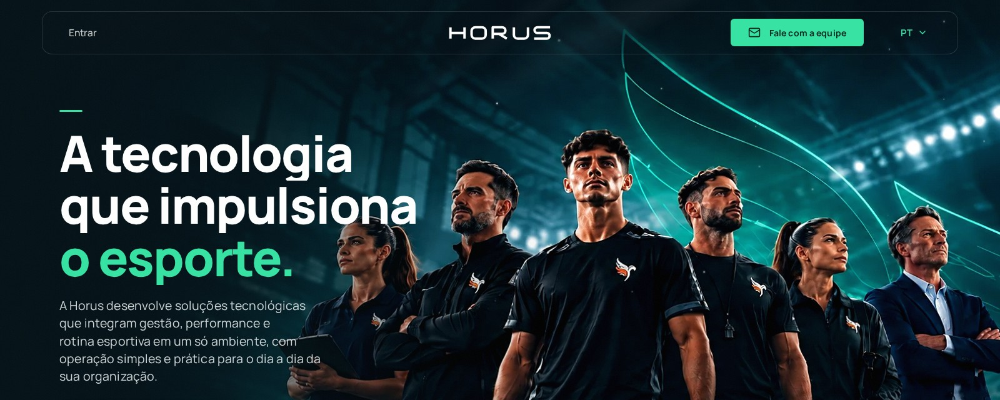
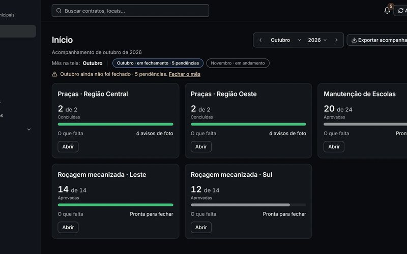
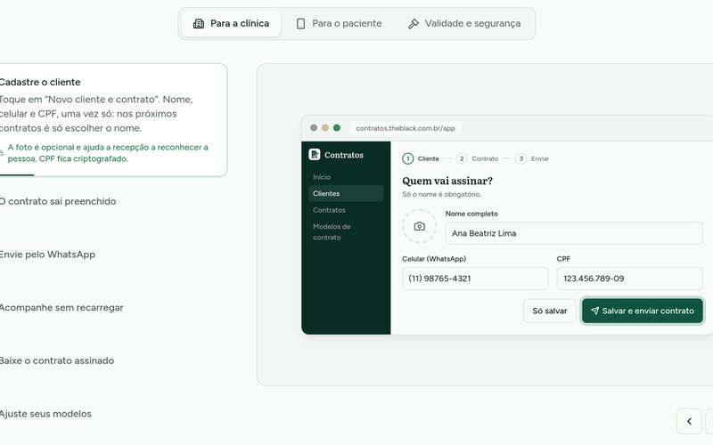
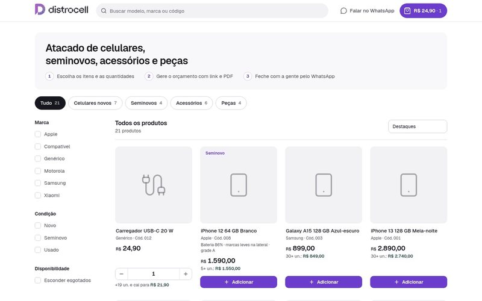
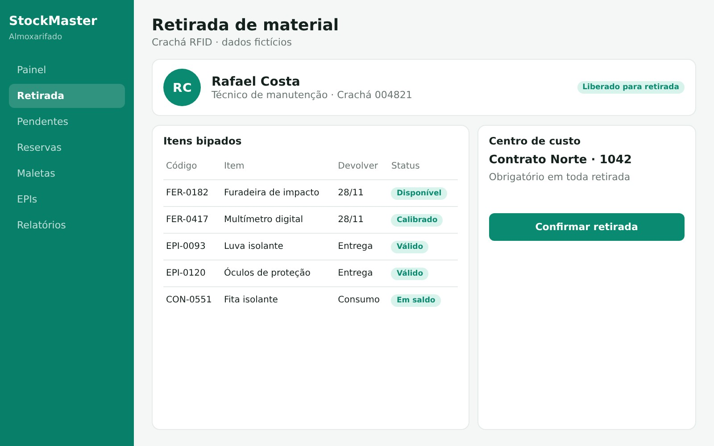
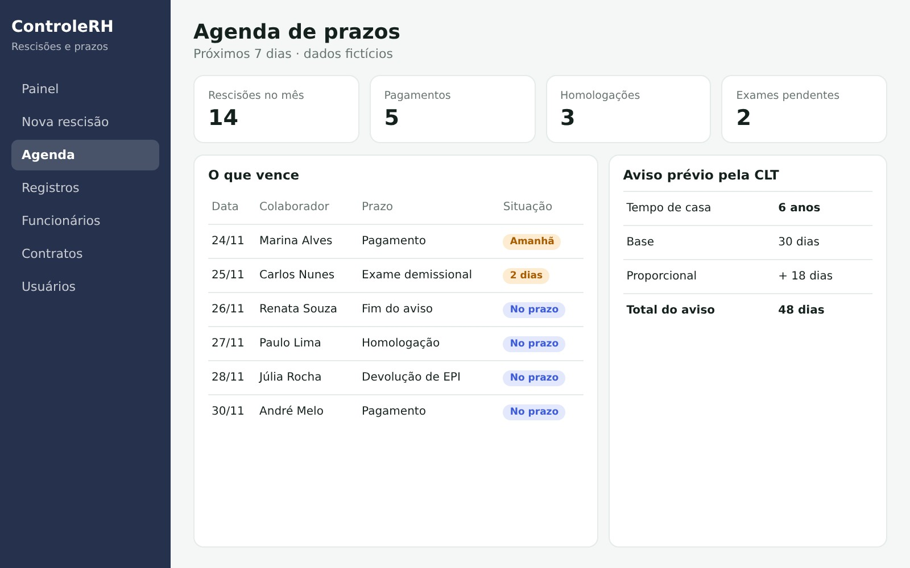
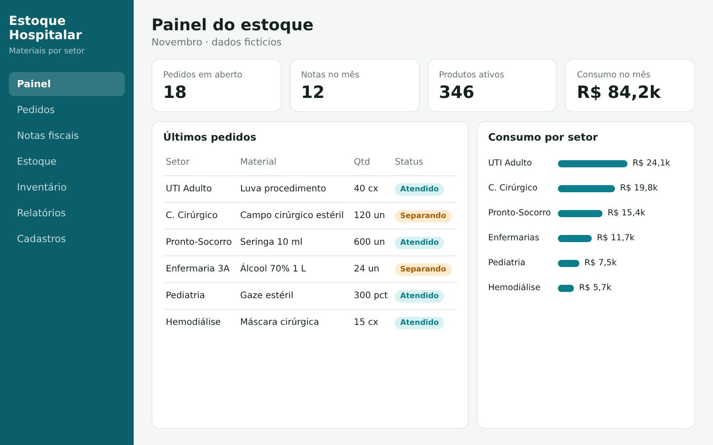
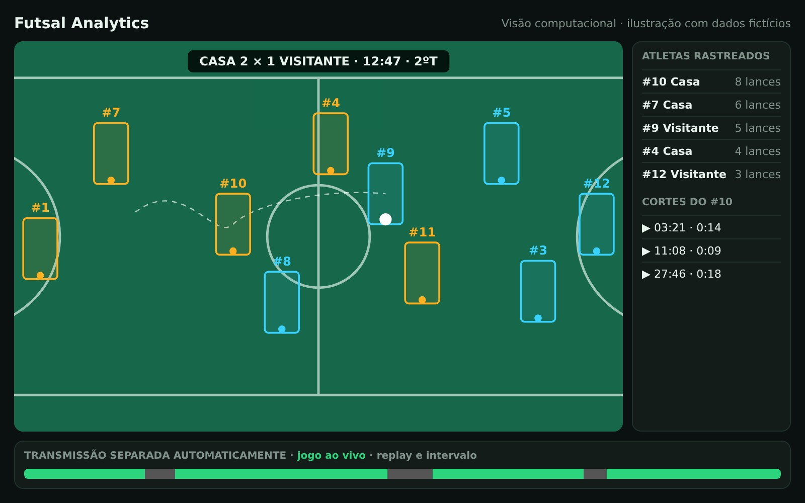
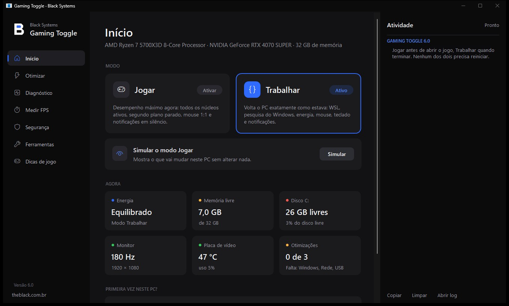

# 👋 Opa, eu sou o João Pedro, o Jotta!

Desenvolvedor full stack e fundador da **[Black Systems](https://theblack.com.br)**.
Crio software para operações que **acontecem na rua e precisam fechar no escritório**: do banco de dados ao app de campo, do painel ao deploy.
Hoje mantenho **sistemas em produção usados todo dia por clientes reais**. Cada um está documentado aqui como estudo de caso.

## 🏗️ Sistemas em produção

O código desses sistemas é privado (são projetos de clientes). Cada estudo de caso mostra o problema, a solução, a arquitetura e as decisões técnicas.

<table>
<tr>
<td colspan="2" valign="top">

<h3>🦅 Horus</h3>
SaaS para clubes de futsal: <b>do scout ao vivo ao prontuário, o clube inteiro num só sistema</b>. Pós-jogo, goleiros, fisioterapia, minutagem e relatórios, com cada clube isolado no próprio banco por RLS e dados sensíveis protegidos pela LGPD. 
FastAPI · React · TypeScript · PostgreSQL (RLS) · Redis · D3 · PWA · Traefik · GitHub Actions 
<a href="https://github.com/Joao-Pedrooo/horus-case">Estudo de caso</a> · <a href="https://dev.scoutlyze.com.br">Conhecer o Horus</a>
</td>
</tr>
<tr>
<td width="50%" valign="top">

<h3>🧭 Operis</h3>
Do serviço feito na rua ao documento de medição, com <b>app de campo que funciona sem internet</b>. 
FastAPI · PostgreSQL · React · Capacitor (Android) · Gotenberg · Docker 
<a href="https://github.com/Joao-Pedrooo/operis-case">Estudo de caso</a> · <a href="https://theblack.com.br/operis">Conhecer o Operis</a>
</td>
<td width="50%" valign="top">

<h3>✍️ Contratos</h3>
Contratos assinados pelo celular, com <b>trilha de auditoria por hash</b> e verificação pública do documento. 
Next.js · TypeScript · PostgreSQL · Prisma · Redis/BullMQ · Docker 
<a href="https://github.com/Joao-Pedrooo/contratos-case">Estudo de caso</a> · <a href="https://contratos.theblack.com.br">Sistema no ar</a>
</td>
</tr>
<tr>
<td width="50%" valign="top">

<h3>📱 DistroCell</h3>
O lojista monta o pedido e recebe na hora um <b>orçamento com link, PDF e WhatsApp</b>, com preço por faixa de quantidade. 
Next.js · TypeScript · PostgreSQL · Prisma · Tailwind · Docker 
<a href="https://github.com/Joao-Pedrooo/distrocell-case">Estudo de caso</a> · <a href="https://distrocell.theblack.com.br">Sistema no ar</a>
</td>
<td width="50%" valign="top">

<h3>📦 StockMaster</h3>
Almoxarifado com <b>retirada por crachá RFID</b>: quem levou o quê, até quando e em qual contrato. 
React · TypeScript · Firebase · Vite · Playwright 
<a href="https://github.com/Joao-Pedrooo/stockmaster-case">Estudo de caso</a>
</td>
</tr>
<tr>
<td width="50%" valign="top">

<h3>🗂️ ControleRH</h3>
Rescisões do começo ao fim, com <b>aviso prévio calculado pela CLT</b> e agenda de prazos para o RH. 
React · TypeScript · Firebase · Cloud Functions 
<a href="https://github.com/Joao-Pedrooo/controlerh-case">Estudo de caso</a>
</td>
<td width="50%" valign="top">

<h3>🏥 Estoque Hospitalar</h3>
Materiais e pedidos de cada setor do hospital, <b>da nota fiscal ao relatório de consumo</b>. 
JavaScript · Firebase (Firestore, Auth, Functions) · GitHub Actions 
<a href="https://github.com/Joao-Pedrooo/estoque-hospitalar-case">Estudo de caso</a>
</td>
</tr>
</table>

## 🧪 Laboratório

<table>
<tr>
<td width="50%" valign="top">

<h3>⚽ Futsal Analytics</h3>
<b>Visão computacional</b> que acompanha cada atleta em quadra, lê o placar e separa os lances do jogo. 
Python · YOLO (Ultralytics) · OpenCV · PyTorch 
<a href="https://github.com/Joao-Pedrooo/futsal-analytics-case">Estudo de caso</a>
</td>
<td width="50%" valign="top">

<h3>🎮 Gaming Toggle</h3>
App gratuito para Windows que alterna o PC entre <b>Jogar</b> e <b>Trabalhar</b>, com otimização reversível, medidor de FPS e diagnóstico. 
C# · WinForms · PowerShell · NVAPI 
<a href="https://theblack.com.br/gaming-toggle">Baixar grátis</a>

</td>
</tr>
</table>

**Também entregues:** 📝 **Admissão digital** (o candidato manda os documentos pelo celular e o RH confere num painel) e ♻️ **Gerador de MTR e CTR** (manifestos de resíduos preenchidos com os dados que a empresa já tem).

## 🚀 O que eu faço

- 🧩 **Sistemas web completos** 
  Do levantamento com o cliente ao sistema no ar: telas em React e Next.js com TypeScript, regras de negócio no servidor e painel administrativo.
- ⚙️ **APIs e back-end** 
  FastAPI com SQLAlchemy, Alembic e Pydantic; Node.js com Express; filas e tarefas em segundo plano com Redis e BullMQ.
- 🗄️ **Dados** 
  PostgreSQL com Prisma e SQLAlchemy, MySQL e Firebase (Firestore, Auth, Storage), com migrações, regras de acesso e backup.
- 📱 **Apps de campo** 
  App Android com Capacitor que registra o serviço sem internet e sincroniza quando o sinal volta.
- 📄 **Documentos e automação** 
  Geração de PDF com Gotenberg, assinatura eletrônica com auditoria, importação de planilhas e integração com WhatsApp.
- 🐳 **Infra e deploy** 
  Docker Compose em servidor Linux na Oracle Cloud, Nginx, Cloudflare Tunnel, deploy com volta automática se a saúde falhar e backup diário.
- 🤖 **Visão computacional** 
  Detecção e rastreamento com YOLO, OpenCV e PyTorch, aplicados a vídeo de esporte.
- ✅ **Qualidade** 
  Testes com Vitest, Playwright e pytest, e regras de banco testadas em emulador.

## 🧰 Ferramentas e tecnologias

### 💬 Linguagens
     

### 🎨 Front-end
      

### ⚙️ Back-end
     

### 🗄️ Bancos de dados e filas
   

### 📱 Mobile
 

### 🐳 Infra e DevOps
       

### 🤖 Visão computacional
  -111F68?style=flat&logo=ultralytics&logoColor=white)

### ✅ Testes
  

## 📂 Projetos abertos

| Projeto | O que é |
|---|---|
| 💉 [e-imune](https://github.com/ImpactaADS5/e-imune) | Projeto em equipe da faculdade: carteira de vacinação digital com histórico, lembretes, campanhas e clínicas próximas (Node.js, Express, TypeScript, Prisma, PostgreSQL) |

## 🎓 Formação

- **Análise e Desenvolvimento de Sistemas**, Faculdade Impacta (conclusão em 2026)

## 📬 Vamos conversar?

Se quiser falar de um projeto, de uma vaga ou só trocar ideia:

- 🌐 [theblack.com.br](https://theblack.com.br)
- ✉️ contato@theblack.com.br
- 📍 Minas Gerais
